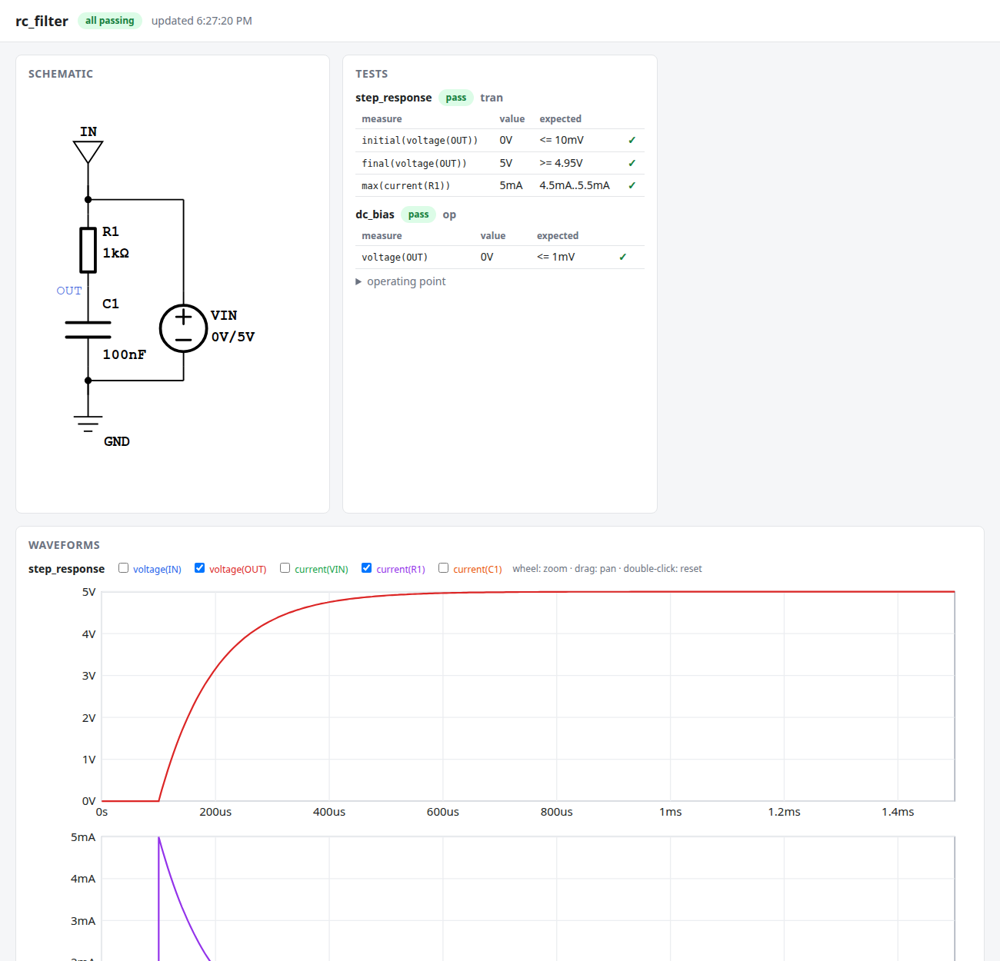
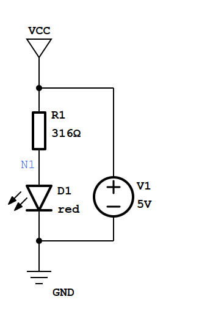
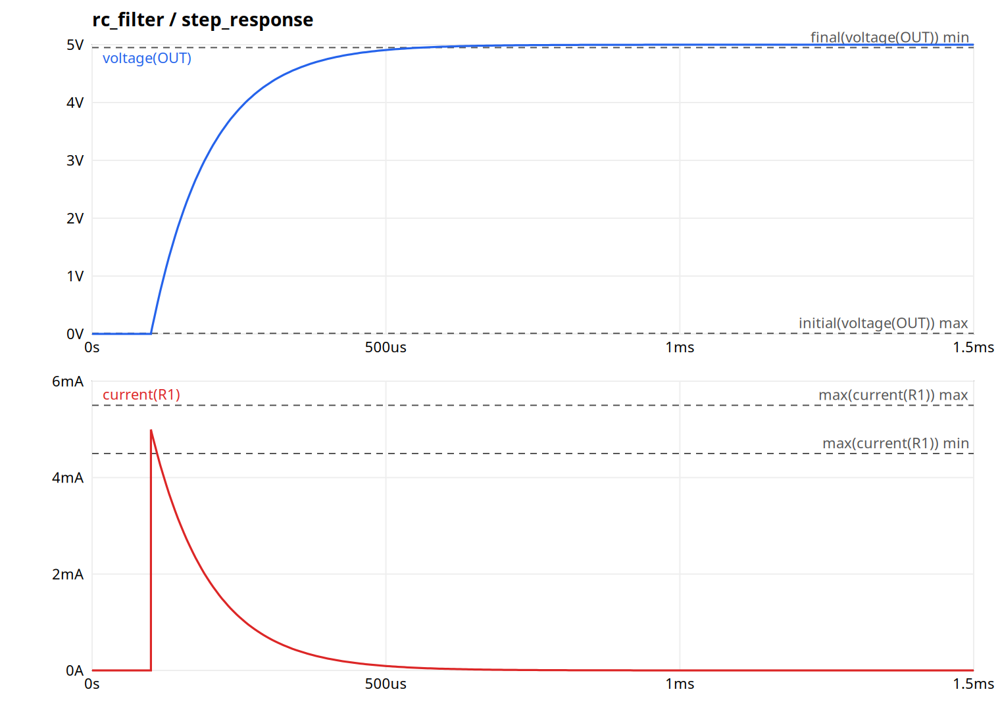
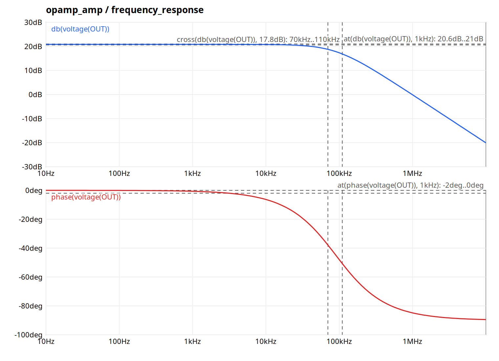
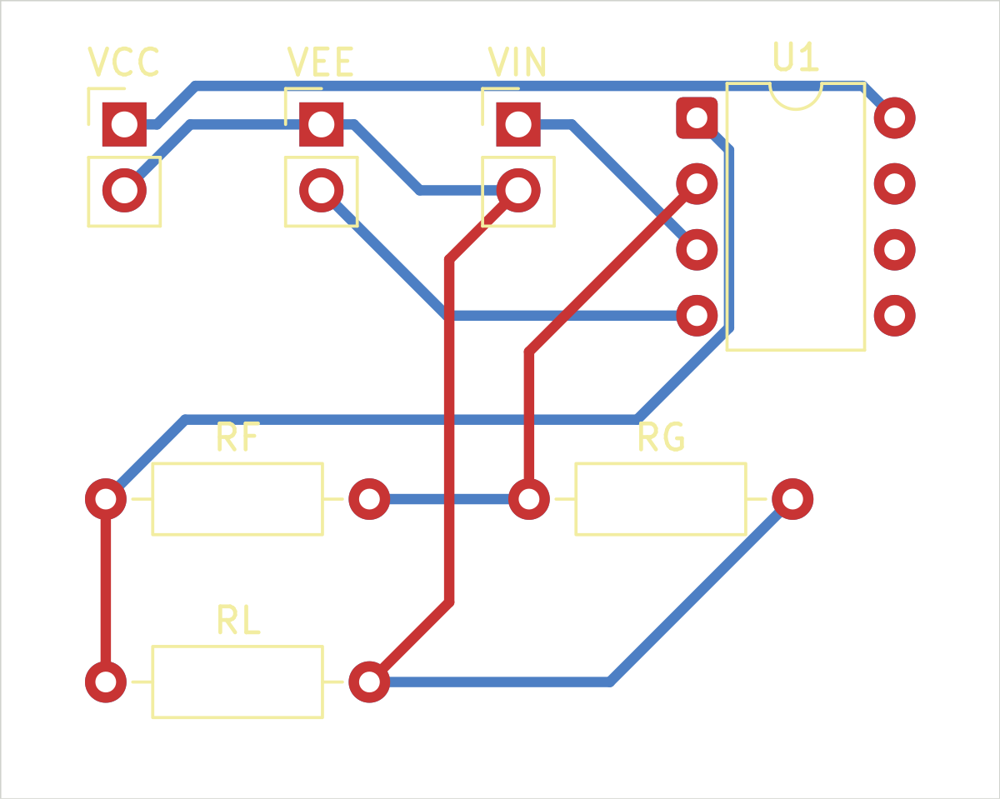
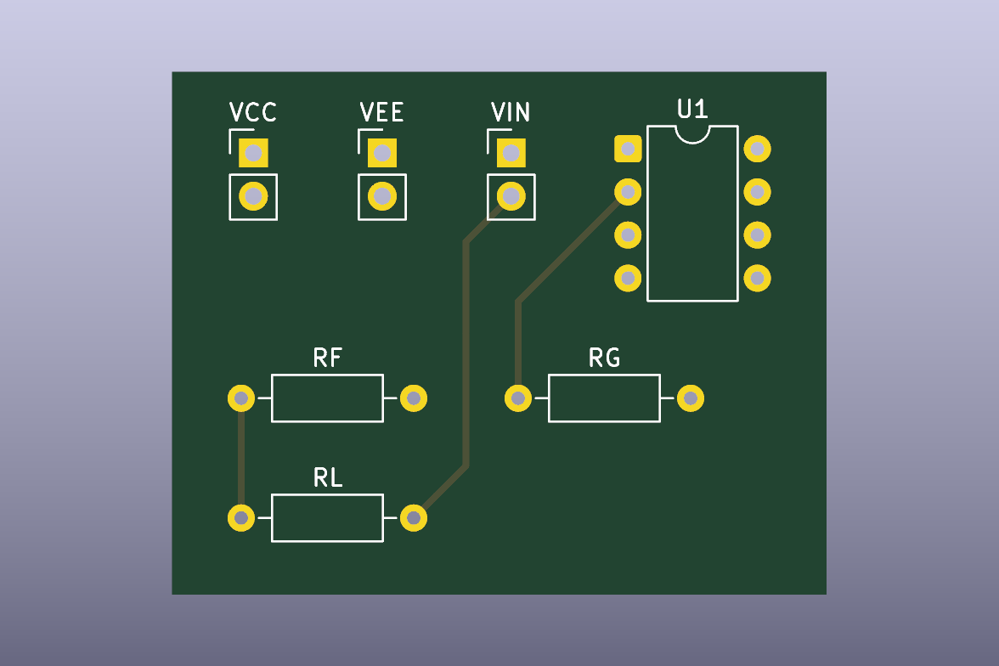

<div align="center">

# ai-eda

**An electronics design toolchain that an AI agent drives through plain files and a CLI.**

You describe the goal. The agent writes the circuit as YAML, simulates it, reads the verdict, fixes the design, and repeats until every requirement passes. You watch it happen in a live browser view.


</div>

<p align="center">
  
</p>

---

## Why

Most EDA tools are built around a mouse and a GUI, which an AI agent cannot use well. ai-eda works the other way around:

- **Text is the source of truth.** Circuits, tests, and parts are human-readable YAML, diffable and versioned with git.
- **Every action is one command** that prints one JSON object, with errors that point at a file, line, and field.
- **Pass/fail is explicit.** Requirements live in `test.yaml`; simulation produces a verdict, not just a plot.
- **The agent can see.** Schematics and waveforms are rendered to SVG and PNG so the agent can inspect what it built.
- **The CLI never designs.** It validates, simulates, and renders. The design decisions belong to the agent and to you.

## A design in two files

```yaml
# design/circuit.yaml
parts:
  V1: { type: dc_voltage_source, voltage: 5V }
  R1: { type: resistor, resistance: 316ohm }
  D1: { type: led, color: red }
nets:
  VCC: [V1.+, R1.1]
  N1:  [R1.2, D1.anode]
  GND: [D1.cathode, V1.-]
```

```yaml
# design/test.yaml
tests:
  led_current:
    analysis: { type: op }
    expect:
      - { measure: current(D1), min: 9.5mA, max: 10.5mA }
      - { measure: voltage(N1), max: 3V }
```

Values always carry a unit (`4.7kohm`, `100nF`, `5ms`), and prefixes are case-sensitive (`m` = milli, `M` = mega), so the common SPICE pitfall of `1M` meaning one *milli*-ohm cannot happen.

## The loop

```console
$ eda run projects/led_demo -m "Start from 470 ohm"
```
```json
{
  "ok": false,
  "errors": [{
    "rule": "expect",
    "message": "led_current: current(D1) = 6.752mA, expected 9.5mA..10.5mA (too low by 2.748mA)",
    "file": "design/test.yaml", "line": 6, "path": "tests.led_current.expect[0]"
  }]
}
```
```console
$ eda value 315ohm -s E96          # nearest real resistor value → 316Ω (+0.32 %)
$ eda run projects/led_demo -m "Fix: (5 V - 1.85 V) / 10 mA ≈ 315 ohm → E96 316 ohm"
```
```json
{ "ok": true, ... "current(D1)": "9.969mA" }
```

Every run is written to the project's `iterations.jsonl` with the note, the changed files, and a semantic diff such as `R1.resistance: 470Ω → 316Ω`.

<table>
<tr>
<td align="center"><br><sub>Auto-laid-out schematic with net labels</sub></td>
<td align="center"><br><sub>Transient waveforms with the test bounds</sub></td>
</tr>
</table>

## Features

| Area | What you get |
|---|---|
| **Design files** | Strict YAML 1.2 (no `no` → `false` surprises, duplicate keys are errors), validated with pydantic; every error has file, line, column, and path |
| **ERC** | Unconnected pins, single-pin nets, missing ground, nets with no DC path, shorts between nets, shorted sources, names that collide in case-insensitive SPICE |
| **Simulation** | ngspice batch runs: operating point (`op`), transient (`tran`), and frequency response (`ac`) |
| **Measures** | `voltage(N)`, `voltage(A, B)`, `current(R1)`, `current(U1.out)` inside `max min avg rms pp initial final`, `at(…, 1kHz)`, `cross(…, -3dB)`, `period(…, 3mA)`, and `db mag phase` — type-checked per analysis, with units |
| **Parts** | One YAML file per part type: pins, typed parameters, SPICE template, schematic symbol. Built in: DC, pulse, and sine sources; R, C, L; diodes (1N4148, 1N4007); LEDs in five colors; a generic op-amp macromodel (gain, GBW, slew rate, swing) |
| **Vendor models** | `eda model inspect` / `eda model import` turn a manufacturer `.subckt` (e.g. TI TL072, TLV9002) into a part, detecting PSpice-compatibility mode automatically |
| **Rendering** | Schematic auto-layout via netlistsvg with a custom skin and net labels; waveform SVGs; PNG copies via CairoSVG for the agent to look at |
| **Boards** | `board.yaml` (outline, rules, optional placement, ground pours) → connectivity-aware auto-placement → KiCad 10 board → Freerouting autorouting → copper fill → `kicad-cli` DRC as JSON → Gerbers, drill, positions, and BOM in one zip |
| **Firmware** | Raspberry Pi Pico (RP2040) part with its full GPIO function table; `firmware.yaml` assigns roles per net; `eda fw` checks functions and conflicts, generates `pins.h` / `pins_init.h`, and scans C sources; `eda fw --build` compiles with the pico-sdk and reports compiler errors by file and line |
| **Firmware in the loop** | `firmware: true` tests run the compiled firmware in an RP2040 emulator (rp2040js) in lock-step with ngspice: GPIO and PWM outputs drive the circuit, inputs and the ADC read node voltages, UART output is checked with regular expressions |
| **Live viewer** | `eda watch` re-runs on every save and pushes updates to a local page: schematic, verdicts, operating point, zoomable waveforms, board layout and 3D view, iteration log |
| **Helpers** | `eda value` for E3 … E192 standard values, `eda part list/show`, `eda log` notes |

### Frequency response, too

```yaml
  frequency_response:
    analysis: { type: ac, start: 10Hz, stop: 10MHz }
    expect:
      - { measure: "at(db(voltage(OUT)), 1kHz)", min: 20.6dB, max: 21dB }
      - { measure: "cross(db(voltage(OUT)), 17.8dB)", min: 70kHz, max: 110kHz }   # -3 dB corner
```

<p align="center">
  
</p>

### From netlist to board

```yaml
# design/board.yaml — everything is optional; unplaced parts go next to what they connect to
board: { spacing: 4mm }
rules: { clearance: 0.2mm, track_width: 0.4mm }
pours: [{ net: GND, layer: bottom }]      # ground plane
```

```console
$ eda pcb projects/tl072_amp
{ "ok": true, "data": { "size_mm": [38.55, 30.81],
  "routing": { "tracks": 27, "vias": 0, "unrouted": 0 },
  "drc": { "errors": 0, "warnings": 0 },
  "outputs": { "fabrication": "out/pcb/tl072_amp-fab.zip", ... } } }
```

<table>
<tr>
<td align="center"><br><sub>Autorouted two-layer board</sub></td>
<td align="center"><br><sub>KiCad 3D render</sub></td>
</tr>
</table>

The YAML stays the source of truth: the KiCad board, routes, and Gerbers are regenerated on every run, and identical designs give identical boards.

### Schematic and firmware stay in sync

```yaml
# design/firmware.yaml — the schematic decides the pin, this file decides the role
mcu: U1
signals:
  LED:     { mode: output, initial: low }
  BUTTON:  { mode: input, pull: up }
  UART_TX: { function: UART0_TX }
```

`eda fw` writes `firmware/pins.h` (`#define PIN_LED 15u`) and a pico-sdk `pins_init()`. Move the LED to GP16 in `circuit.yaml` and the header follows; move `UART_TX` to GP2 and you get *"UART0_TX is not available on GP2; it is on GP0, GP12, GP16, GP28"*. Tests can set firmware pin levels (`pins: { LED: high }`) and check the analog result.

### Firmware runs against the circuit

```yaml
  firmware_button:
    analysis: { type: tran, step: 1ms, stop: 1.2s }
    firmware: true                                   # compiled main.c in an RP2040 emulator
    parts: { SW1: { state: pressed }, RV1: { position: 25% } }
    expect:
      - { measure: "period(current(D1), 3mA)", min: 190ms, max: 210ms }   # faster blink
      - { serial: UART_TX, match: 'pot=(\d+)', min: 950, max: 1100 }     # ADC via printf
```

The firmware reads the button through the switch and the pull-up it enabled itself, reads the potentiometer through the ADC, and drives the LED that ngspice simulates; change the delay in `main.c` and the test fails with the new period.

Things can also happen during a run: `events: [{ at: 1.1s, part: SW1, set: { state: pressed } }, { at: 300ms, serial: UART_RX, send: "rate 100\n" }]`, with measures limited to part of it (`from: 1.6s`).

### Vendor models

Manufacturer SPICE models are imported locally and are **not** part of this repository, because their licenses usually forbid redistribution:

```bash
uv run eda model inspect TL072.301                       # find the .subckt and its pin comments
uv run eda model import TL072.301 --id tl072 --opamp 1,2,3,4,5
uv run eda run projects/tl072_amp                         # real-IC example
```

Imported parts land in `parts/vendor/` (git-ignored). ngspice's source tarball includes several TI models under `examples/` if you want something to try.

## Quick start

Requirements: Python 3.13 with [uv](https://docs.astral.sh/uv/), [ngspice](https://ngspice.sourceforge.io/) on `PATH`, Node.js (for schematic layout), and the system cairo library (present on most Linux desktops). For boards: [KiCad 10](https://www.kicad.org/) (`kicad-cli` and its Python `pcbnew` module) and Java 21. For firmware: `arm-none-eabi-gcc`, CMake, and ngspice built as a shared library too (`libngspice`, for co-simulation).

```bash
git clone https://github.com/TechieQuokka/ai-eda.git
cd ai-eda
uv sync                              # Python dependencies
npm --prefix tools/netlistsvg ci     # schematic auto-layout engine
tools/freerouting/fetch.sh           # autorouter (only needed for boards)
# firmware (pico_io): sudo apt install gcc-arm-none-eabi libnewlib-arm-none-eabi cmake
tools/fetch-pico-sdk.sh              # pico-sdk 2.3.1 into tools/pico-sdk/
npm --prefix tools/rp2040 ci         # RP2040 emulator
tools/rp2040/fetch-bootrom.sh        # its boot ROM (needs arm-none-eabi-objcopy)

uv run eda run projects/led_demo     # check → simulate → render
uv run eda watch projects/rc_filter  # live viewer at http://127.0.0.1:8765/
```

| Command | Purpose |
|---|---|
| `eda check [PROJECT]` | Validate files, run ERC, compile tests |
| `eda sim [PROJECT] [-t TEST]` | Simulate and judge every expectation |
| `eda render [PROJECT]` | Schematic and waveform SVG/PNG |
| `eda fw [PROJECT] [--build]` | Firmware: check pin roles, generate `pins.h` / `pins_init.h`, scan sources; `--build` compiles |
| `eda pcb [PROJECT]` | Board: build, autoroute, DRC, Gerbers/drill/BOM |
| `eda run [PROJECT] [-m NOTE]` | check → sim → render (→ pcb) in one call, logged with an optional note |
| `eda watch [PROJECT]` | Re-run on change and serve the live viewer |
| `eda value TARGET [-s E24]` | Nearest standard component values |
| `eda part list` / `eda part show ID` | Inspect the part database |
| `eda model inspect FILE` / `eda model import FILE --id ID` | Bring in a vendor SPICE model |
| `eda log [PROJECT] -m TEXT` | Add a note to the iteration log |

Exit codes: `0` all checks pass, `1` the design has errors, `2` a tool or the environment failed.

## Using it with an AI agent

The repository's [`CLAUDE.md`](CLAUDE.md) is the working contract for an agent such as Claude Code: the design loop, how to read the JSON errors, and how to record each iteration. Give the agent a goal ("drive a red LED at 10 mA from 5 V"), start `eda watch` for yourself, and watch the iterations arrive.

## Roadmap

| Milestone | Scope | Status |
|---|---|---|
| **M0** | Text design → ngspice → JSON verdict → schematic and waveforms → live viewer | ✅ Done |
| **M1** | Vendor SPICE models (`.lib` subcircuits), op-amps, AC analysis | ✅ Done |
| **M2** | KiCad board generation, `kicad-cli` DRC and Gerber export, auto-routing | ✅ Done |
| **M3** | Firmware integration: generated `pins.h`, schematic/firmware cross-checks | ✅ Done |
| **M4** | Firmware build, MCU emulation co-simulated with the analog circuit | ✅ Done |

Background and decisions: [`PROJECT_SUMMARY.md`](PROJECT_SUMMARY.md), [`DESIGN_DECISIONS.md`](DESIGN_DECISIONS.md).

## Development

```bash
uv run ruff format --check && uv run ruff check   # style and lint
uv run pyright                                    # strict static typing
uv run pytest                                     # 163 tests
```

---

## License

Copyright © 2026 TechieQuokka. All rights reserved except as granted below.

ai-eda is **source-available under a dual licensing model**. The full terms are in [`LICENSE`](LICENSE); this section is a summary.

### 🎓 Free for learning and non-commercial use

You may use, copy, and modify ai-eda **free of charge** for:

- personal learning and self-study,
- teaching, coursework, and academic research,
- hobby projects and other non-commercial experimentation.

Keep this license notice in any copy or derivative you share.

### 💼 Commercial use requires a paid license

A separate **commercial license (paid)** is required for any commercial use, including but not limited to:

- using ai-eda, or designs and outputs produced with it, in work done for profit or for a client,
- integrating ai-eda into a commercial product, service, or internal business tool,
- offering ai-eda or a derivative as a hosted or paid service.

To obtain a commercial license, please [open an issue](https://github.com/TechieQuokka/ai-eda/issues) with the title **"Commercial license inquiry"** or contact the maintainer through the GitHub profile [@TechieQuokka](https://github.com/TechieQuokka). Pricing depends on the size of the organization and the intended use.

If you are unsure whether your use counts as commercial, ask before using it.

### Third-party components

ai-eda relies on, but does not relicense, the following projects. Each keeps its own license:

| Component | License | How it is used |
|---|---|---|
| [netlistsvg](https://github.com/nturley/netlistsvg) | MIT, © 2016 Neil Turley | Schematic layout (installed via npm). `src/eda/render/skin.svg` is a modified copy of its analog skin and stays under the MIT license |
| [ngspice](https://ngspice.sourceforge.io/) | BSD-3-Clause (mostly) | External simulator, not bundled |
| [KiCad](https://www.kicad.org/) and its libraries | GPL-3.0; libraries CC-BY-SA 4.0 with a design exception | External tool, not bundled; generated boards may use its footprints freely |
| [Freerouting](https://github.com/freerouting/freerouting) | GPL-3.0 | External autorouter, downloaded by `tools/freerouting/fetch.sh`, not bundled |
| [pydantic](https://github.com/pydantic/pydantic), [ruamel.yaml](https://sourceforge.net/projects/ruamel-yaml/), [watchfiles](https://github.com/samuelcolvin/watchfiles) | MIT | Python dependencies |
| [CairoSVG](https://github.com/Kozea/CairoSVG) | LGPL-3.0-or-later | Python dependency (dynamically imported, unmodified) |
| Vendor SPICE models (TI, ADI, …) | Each vendor's own terms | **Not included.** Imported locally into the git-ignored `parts/vendor/` |

Built-in SPICE model parameters for the 1N4148 and 1N4007 follow widely published manufacturer-style models; the LED models and the generic op-amp macromodel (`parts/models/eda_opamp.lib`) are written by this project.

### Disclaimer

The software is provided "as is", without warranty of any kind. Simulation results are approximations; verify real hardware against datasheets and measurements before relying on it.
